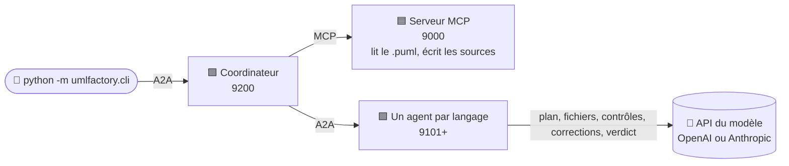

<div align="center">

# 🏭 UML Factory

**Du diagramme PlantUML au code source, écrit par un modèle d'IA, puis comparé au diagramme.**

`Python 3.13` · `Java` · `Python` · `PHP` · `+ vos langages` · `OpenAI` · `Anthropic`

</div>

---

Transforme un diagramme PlantUML (`.puml`) en code source, **écrit par un modèle d'IA** (ni regex, ni gabarits).
Vous choisissez le fichier, le ou les langages cibles et le dossier de destination, puis vous suivez la génération en
direct. À la fin, le code est comparé au diagramme et le modèle rend un verdict de conformité.



| 1️⃣ Vous choisissez | 2️⃣ Le modèle écrit | 3️⃣ Le code est contrôlé | 4️⃣ Verdict |
|---|---|---|---|
| fichier `.puml`, langage(s), dossier | un plan de fichiers, puis chaque fichier | compilation, noms comparés au diagramme, corrections | 🟢 conforme · 🟡 partiel · 🔴 non conforme |

## Installation (une seule fois)

Pas d'installation du projet : seulement ses dépendances (`requirements.txt`, testé avec Python 3.13). Toutes les
commandes se lancent **depuis le dossier du dépôt**.

```
python -m pip install -r requirements.txt
copy .env.example .env                 (Linux/macOS : cp .env.example .env)
```
Puis ouvrir `.env` et renseigner **une** des deux configurations (voir « Réglages du fichier `.env` ») :

- OpenAI ou compatible : `OPENAI_API_URL`, `OPENAI_API_KEY` et `OPENAI_MODEL` ;
- Anthropic (Claude) : `ANTHROPIC_API_KEY`.

> Écrire `python -m pip` plutôt que `pip` : cela évite le lanceur `pip.exe`, parfois bloqué par Windows Defender.

Pour Java, un JDK (commandes `javac` et `java`) permet de compiler et d'exécuter le code généré pour le contrôler.
Sans JDK, le code Java est généré mais pas compilé (c'est indiqué à l'écran).

## Démarrage rapide

```
python -m umlfactory.cli
```
C'est tout. Le programme allume lui-même ce dont il a besoin (voir « La pile »), puis pose trois questions : le
**fichier `.puml`** (les fichiers du dossier `examples/` sont proposés), le **langage cible** (menu des langages
disponibles, avec l'entrée **« Autre langage… »**) et le **dossier de destination** (par défaut `sortie/`). Il éteint
tout à la fin.

### Se déplacer dans les menus

| Touche | Effet |
|---|---|
| `↑` `↓` | Se déplacer |
| `Espace` | Cocher ou décocher (menu des langages : vous pouvez en choisir plusieurs) |
| `Entrée` | Valider |
| `←` ou `Échap`, **deux fois** | Revenir à l'étape précédente (un seul appui affiche un rappel, pour éviter les retours par accident) |
| Ligne « ← Retour » + `Entrée`, **deux fois** | Même effet (« ✕ Quitter » à la première étape) |
| `<` puis `Entrée` | Revenir en arrière dans une question à taper (chemin, dossier) |

Sans terminal interactif (redirection, CI), les menus deviennent des listes numérotées et il faut donner les options
sur la ligne de commande.

## La pile : ce qui tourne derrière la commande

UML Factory est composé de petits programmes qui tournent **sur votre PC uniquement** (ils n'écoutent que sur
`127.0.0.1`, rien n'est exposé sur le réseau) :

| Composant | Rôle | Port par défaut |
|---|---|---|
| 🟦 Serveur MCP | Lit le `.puml` et écrit les fichiers générés | 9000 |
| 🟪 Coordinateur | Répartit le travail entre les agents et gère l'ajout de langages | 9200 |
| 🟩 Agents de langage | Un par fichier de `umlfactory/generators/` (`java`, `python`, `php`…) : ils parlent au modèle | 9101 et suivants |

Ensemble, ils forment **la pile**. Vous n'avez rien à lancer vous-même :

| Situation | Ce que fait la commande | Ce que vous voyez |
|---|---|---|
| 🟢 La pile n'est pas allumée (cas normal) | Elle l'allume, fait la tâche, puis l'éteint | `✔ Pile prête` au début |
| 🟡 La pile est déjà allumée | Elle l'utilise telle quelle et ne l'éteint pas | Rien : c'est plus rapide |
| 🔴 L'adresse du coordinateur est distante, ou la pile ne démarre pas | Elle s'arrête avec un message clair | `Erreur : …` et le journal à lire dans `logs/` |

La pile n'est démarrée automatiquement que si `COORDINATOR_URL` est une adresse locale (`127.0.0.1`, `localhost`).

### Laisser la pile allumée : `--keep-running` et `--stop`

Pour enchaîner plusieurs conversions sans attendre l'allumage à chaque fois :

```diff
+ python -m umlfactory.cli model.puml --lang java -o sortie --keep-running
+ ✔ La pile reste allumée en arrière-plan. Pour l'arrêter : python -m umlfactory.cli --stop
```
Les conversions suivantes démarrent aussitôt. Pour tout éteindre :

```diff
+ python -m umlfactory.cli --stop
+ Pile trouvée : serveur MCP (port 9000), coordinateur (port 9200), agent java (port 9101), ...
+   ✔ arrêté      serveur MCP (port 9000)
+ ✔ Pile arrêtée (5 composant(s)).
```
S'il n'y avait rien à arrêter, un message simple le dit (code de sortie `1`), sans trace technique :

```diff
- Aucune pile UML Factory n'était active (rien à arrêter).
```
Les composants gardés allumés sont notés dans `.umlfactory-stack.json` (ignoré par git). `--stop` n'arrête un
composant que si son port répond encore.

### Pile au premier plan : `python -m umlfactory.deploy`

Variante de `--keep-running` : la pile reste allumée **dans ce terminal**, que vous laissez ouvert pour voir ce qui se
passe. `Ctrl+C` arrête tout. Les journaux de chaque composant sont dans `logs/` (utile si quelque chose ne démarre
pas). Une pile lancée ainsi s'arrête avec `Ctrl+C`, pas avec `--stop`.

## Commande principale : `python -m umlfactory.cli`

```
python -m umlfactory.cli [fichier.puml] [options]
```

Tout ce qui n'est pas donné en option est demandé interactivement.

| Option | Ce que ça fait |
|---|---|
| `fichier.puml` | Le diagramme à convertir. Demandé si absent. |
| `-o`, `--out DOSSIER` | Où écrire le code généré. Demandé si absent. Le dossier est créé s'il n'existe pas. |
| `--lang java` | Langage cible, sans passer par le menu. Plusieurs possibles : `--lang java python` (chacun dans son sous-dossier). |
| `--list-languages` | Affiche les langages disponibles puis s'arrête. |
| `--ask "en Python"` | Au lieu de `--lang`, une phrase libre : le modèle en déduit le langage. `--lang` est plus fiable. |
| `--package com.exemple.banque` | Nom du package Java (ou du dossier-package Python). Sans lui, aucun package n'est utilisé. |
| `--instructions "ajoute des javadoc"` | Consigne libre ajoutée à la demande envoyée au modèle. |
| `--layout auto\|by-language\|flat` | `auto` (défaut) : un sous-dossier par langage **seulement s'il y en a plusieurs**. `by-language` : toujours un sous-dossier (`sortie/java/`). `flat` : tout directement dans le dossier de destination (un seul langage). |
| `--overwrite`, `-y`, `--yes` | Remplace sans demander les fichiers existants du même nom. Sans cette option, la CLI demande confirmation si le dossier n'est pas vide. |
| `--add-language NOM` | Ajoute un langage cible (ex. `Go`) avant de générer : voir « Ajouter un langage ». |
| `--approve` | Autorise sans demander la commande de vérification d'un langage ajouté (usage sans terminal interactif). |
| `--keep-running` | Laisse la pile allumée en arrière-plan après la tâche. |
| `--stop` | Arrête la pile laissée allumée par `--keep-running`, puis quitte. |
| `--coordinator URL` | Adresse du coordinateur si elle diffère de `COORDINATOR_URL`. |
| `--reset-model` | Oublie le fournisseur mémorisé (`.umlfactory.json`) et le redemande. |
| `--provider openai\|anthropic` | Force le fournisseur du modèle, sans le choisir au lancement. |
| `-h`, `--help` | Affiche l'aide et quitte. |

### Exemples

```
python -m umlfactory.cli                                                      tout en interactif
python -m umlfactory.cli model.puml --lang java -o C:\projets\banque
python -m umlfactory.cli model.puml --lang java python -o sortie              deux langages : sortie\java et sortie\python
python -m umlfactory.cli model.puml --lang java --package com.exemple.banque -o sortie
python -m umlfactory.cli model.puml --lang java --instructions "utilise des records quand c'est possible" -o sortie
python -m umlfactory.cli --list-languages
```

Une option inconnue ou une valeur incorrecte donne un message court, jamais une trace Python :

```diff
- Option incorrecte : option inconnue : --bidule
- Pour voir les options : python -m umlfactory.cli --help
```
Une erreur imprévue affiche `Erreur inattendue : …` et le détail technique est écrit dans `logs/erreur.log`.

### Choix du fournisseur de modèle

Au lancement, les clés présentes dans `.env` sont testées (une simple requête). Si une seule est valide, elle est
utilisée. Si les deux le sont, la CLI demande lequel utiliser, une seule fois : le choix est mémorisé dans
`.umlfactory.json` (`--reset-model` pour changer, `--provider` pour l'imposer). Un serveur local sans clé (Ollama, LM
Studio…) fonctionne avec `OPENAI_API_URL` et `OPENAI_MODEL` seuls.

### Pendant la génération

La progression s'affiche en direct : une ligne par langage, une ligne par fichier avec son état (*en attente du
modèle*, *réflexion*, *écriture*, *correction*, ✔ terminé) et le temps écoulé. Si rien ne bouge pendant longtemps, c'est
le modèle qui réfléchit. `Ctrl+C` interrompt.

Code de sortie : `0` tout s'est bien passé, `1` erreur ou échec d'un langage, `2` option incorrecte, `130` interrompu.

## Vérification du code généré

Après la génération, chaque fichier est contrôlé, puis **le modèle rend un verdict de conformité** avec le diagramme.
Il n'y a pas de note chiffrée.

### Ce qui est contrôlé, étape par étape

1. **Contrôles propres au langage** (Java : parenthèses et accolades équilibrées ; Python : syntaxe et imports
   circulaires).
2. **Compilation** (budget de 10 secondes pour l'ensemble de la vérification) :
   - **Java** : `javac`, puis un petit programme de test exécuté avec `java` ;
   - **Python** : import de chaque module dans un sous-processus contrôlé ;
   - **langage ajouté (PHP…)** : la commande de vérification de sa spécification (par exemple `php -l`).
3. **Comparaison avec le diagramme, par les noms** (casse et `_` ignorés : `getNom` = `get_nom`) :
   - Java et Python : par réflexion, en plus d'instancier chaque classe concrète avec des valeurs par défaut (aucune
     opération n'est appelée) ;
   - langage ajouté : recherche des noms dans le fichier de chaque classe.

   Sont comparés : les classes, interfaces et énumérations, l'héritage et les réalisations d'interfaces, les
   attributs, les opérations et les relations.
4. **Boucle de correction** : les erreurs repartent au modèle, qui corrige le fichier concerné (2 tours au maximum).
   Ce qui reste invalide est signalé en avertissement, jamais caché.
5. **Verdict du modèle** : le modèle relit le diagramme et le code, avec les constats précédents, puis répond :

```diff
+ ✔ Conforme au diagramme
  ⚠ Partiellement conforme au diagramme
      - méthode deposer() de Compte
- ✘ Non conforme au diagramme
  ? Non vérifié : le diagramme n'a pas pu être analysé
```

| Verdict | Signification |
|---|---|
| 🟢 Conforme | Rien ne manque. Impossible s'il reste des erreurs que la correction n'a pas résolues. |
| 🟡 Partiellement conforme | Des éléments manquent : ils sont listés (8 au maximum). |
| 🔴 Non conforme | Le code ne représente pas le diagramme. |
| ⚪ Non vérifié | Diagramme illisible, ou le modèle n'a pas répondu : la raison est affichée. |

Si la compilation ou l'exécution n'a pas pu avoir lieu (outil absent comme `javac`, délai dépassé, appels sensibles),
une ligne « Compilation non vérifiée : … » est ajoutée. Dans ce cas, le code est tout de même généré.

### Ce qui n'est PAS vérifié

- Le **comportement** : les méthodes ne sont pas appelées, les règles métier ne sont pas testées.
- Les **types**, les **paramètres**, les valeurs de retour et la **visibilité** : seuls les noms sont comparés.
- Une **relation** est repérée si la classe désigne l'autre classe (par un champ ou une propriété), sans contrôler le
  type exact ni le sens.
- Le verdict est **rendu par le modèle** : il s'appuie sur les constats automatiques, mais c'est un avis, pas une
  preuve.

### Garde-fous à l'exécution

Il n'y a **pas d'isolation système** (pas de Docker) : le code vérifié tourne avec vos droits, dans un dossier
temporaire jetable, avec un environnement nettoyé (ni clé d'API ni variable du `.env`). Avant toute exécution, un scan
des appels sensibles (processus, réseau, fichiers, variables d'environnement) bloque l'exécution s'il en trouve.
Au-delà du budget de 10 secondes, le résultat est « non vérifié », jamais « réussi ».

## Ajouter un langage

Menu **« Autre langage… »** (ou `--add-language Go`). Chaque étape est affichée :

1. **Brouillon** : le modèle rédige des *données* (règles de génération, outils requis, commande de vérification,
   consignes de conformité), gardées dans `umlfactory/.drafts/` le temps de l'opération. Il n'écrit aucun code Python et
   n'exécute rien.
2. **Outils sur l'appareil** : les exécutables nécessaires sont cherchés sur votre machine. S'ils manquent, le modèle
   écrit un **guide d'installation en texte** (`umlfactory/.drafts/<langage>.install.txt`) ; rien n'est installé par
   lui. Suivez le guide, puis revenez : la CLI revérifie.
3. **Validation de la commande** : la commande de vérification est affichée et vous devez l'autoriser. Elle est limitée
   à une liste de compilateurs connus, sans shell.
4. **Test de l'agent** : il convertit des diagrammes de référence (test rapide ou complet), le code est compilé et
   comparé au diagramme. Il faut atteindre un score interne de **75/100** en moyenne pour être « validé » ; en dessous,
   le langage est « expérimental » et vous décidez de le garder ou non. Les règles de génération (jamais la commande)
   peuvent être reformulées une fois par le modèle à partir des échecs.
5. **Fichier d'agent créé** : `umlfactory/generators/<langage>.py`, généré depuis un gabarit fixe (une sous-classe de
   `CommandGenerator` avec quelques attributs, dont `conformity_rules`, les conseils donnés au modèle pour relire le
   code face au diagramme). C'est le même format que `java.py`, modifiable à la main. Le langage est **disponible**
   immédiatement dans le menu.

Les fichiers de projet qui exécutent du code à la compilation (`build.rs`, `*.csproj`, `package.json`, scripts) sont
refusés. Pour retirer un langage (ajouté ou intégré) : supprimer son fichier dans `umlfactory/generators/`. Le noyau
n'a pas à changer.

### À la main (code)

Créer **un seul fichier** `umlfactory/generators/<langage>.py` (le nom du fichier est l'identifiant du langage) :

```python
from ._declarative import CommandGenerator

class KotlinGenerator(CommandGenerator):
    language = "kotlin"
    display_name = "Kotlin"
    file_extensions = (".kt",)
    plan_rules = "one file per class, named <TypeName>.kt."
    style_rules = "Kotlin rules:\n- Use data classes where it fits...\n"
    tools = ("kotlinc",)
    build = ("kotlinc", "{file}")
    conformity_rules = "- An attribute is a `val` or `var` property.\n- An operation is a `fun name(` declaration.\n"
```
Au prochain lancement de la pile, l'agent est démarré automatiquement et **Kotlin apparaît dans le menu**, sans
modifier le coordinateur ni la CLI. Pour un langage avec sa propre vérification d'exécution, voir `java.py` et
`python.py` (sous-classes de `BaseGeneratorAgent` avec une méthode `runtime()`).

## Structure du dépôt

```
.
├── .env.example            à copier en .env (fournisseur, URL, modèle, clé)
├── requirements.txt
├── examples/               diagrammes proposés par la CLI (model.puml, banque_grand.puml)
├── sortie/                 code généré par défaut (ignoré par git)
├── logs/                   journaux de la pile et logs/erreur.log (ignoré par git)
├── tests/                  python -m unittest discover -s tests
└── umlfactory/
    ├── cli.py              point d'entrée : questions, progression, --keep-running, --stop
    ├── deploy.py           démarre / arrête la pile (MCP, coordinateur, un agent par langage)
    ├── coordinator.py      agent coordinateur (A2A) + gestion des langages
    ├── skills.py           créer un langage, vérifier ses outils, le valider
    ├── providers.py        test des clés d'API et choix du fournisseur
    ├── config.py           lecture du .env, adresses, fournisseurs
    ├── verify.py           contrôle local du code généré (exécution contrôlée, comparaison des noms)
    ├── umlmodel.py         lecture minimale du PlantUML, pour CONTRÔLER le code (ne génère rien)
    ├── languages.py        règles de sécurité des langages ajoutés + génération de leur fichier d'agent
    ├── eval_corpus.py      diagrammes de référence pour tester un agent de langage
    ├── mcp_server.py       serveur MCP (lecture du .puml, écriture des sources)
    ├── generators/         UN FICHIER PAR LANGAGE : java.py, python.py, php.py…
    │                       (base.py, planning.py, prompts.py, repair.py, _declarative.py : code commun)
    ├── ui/                 affichage (term.py, progress.py) et menus (prompts.py)
    └── llm.py, a2a_common.py, mcp_client.py, paths.py, textutil.py
```

## Réglages du fichier `.env`

Seules les variables ci-dessous sont lues par le programme.

| Variable | Explication |
|---|---|
| `OPENAI_API_URL` | Adresse de l'API OpenAI ou compatible (`/v1` ajouté automatiquement s'il manque). Obligatoire avec `OPENAI_MODEL`. |
| `OPENAI_API_KEY` | Clé d'API. Peut rester vide pour un serveur local sans authentification. |
| `OPENAI_MODEL` | Nom exact du modèle chez ce fournisseur. |
| `OPENAI_REASONING_EFFORT` | `low`, `medium` ou `high` pour les modèles qui raisonnent. Non envoyé par défaut. |
| `OPENAI_EXTRA` | Paramètres JSON ajoutés à chaque requête, ex. `{"reasoning_effort": "low"}`. |
| `ANTHROPIC_API_KEY` | Clé d'API Anthropic. |
| `ANTHROPIC_API_URL` | Adresse de l'API Anthropic (défaut : `https://api.anthropic.com`). |
| `ANTHROPIC_MODEL` | Modèle Claude (défaut : `claude-haiku-5-5`). |
| `ANTHROPIC_THINKING` | Réflexion étendue : `off` (défaut), `low`, `medium` ou `high`. |
| `OPENAI_TIMEOUT` | Attente maximale (secondes) d'une réponse du modèle. Défaut 600. S'applique aux deux fournisseurs. |
| `OPENAI_CONCURRENCY` | Nombre de fichiers écrits en parallèle. Défaut 5 ; mettre 1 pour un petit modèle local. |
| `OPENAI_TEMPERATURE` | Créativité du modèle. Non envoyée par défaut. Ignorée par Anthropic quand la réflexion est active. |
| `OPENAI_MAX_TOKENS` | Longueur maximale d'une réponse. Non envoyée par défaut chez OpenAI ; chez Anthropic, 8192 si absente. |
| `UMLFACTORY_PROVIDER` | `openai` ou `anthropic` : fournisseur à utiliser quand les deux clés existent. Écrit par la CLI après le choix. |
| `NO_COLOR` | Variable standard : si elle existe, l'affichage se fait sans couleurs. |
| `MCP_URL`, `COORDINATOR_URL` | Adresses du serveur MCP et du coordinateur (défauts : ports 9000 et 9200). |
| `GENERATOR_PORT_RANGE` | Plage de ports où les agents de langage sont cherchés et lancés. Défaut `9101-9150`. |
| `GENERATOR_AGENT_URLS` | Agents de langage supplémentaires hors de cette plage (autre machine), séparés par des virgules. |

## Composants à la main (usage avancé)

| Commande | Rôle | Défaut |
|---|---|---|
| `python -m umlfactory.mcp_server [--port N]` | Serveur MCP : lit le `.puml`, écrit les fichiers | port 9000 |
| `python -m umlfactory.coordinator [--port N]` | Agent coordinateur | port 9200 |
| `python -m umlfactory.generators java --port 9101` | Agent d'un langage (nom du fichier dans `generators/`) | à préciser |

## Tests

```
python -m unittest discover -s tests
```
Les tests Java sont ignorés si `javac` et `java` ne sont pas disponibles.

## Problèmes courants

| Symptôme | Solution |
|---|---|
| `pip` ne fait rien / bloqué par Windows | Utiliser `python -m pip install -r requirements.txt`. |
| `ModuleNotFoundError: No module named ...` | Dépendances absentes de ce Python : lancer `python -m pip install -r requirements.txt`. |
| `le coordinateur ne répond pas` | `COORDINATOR_URL` du `.env` est une adresse distante ou fausse : la pile n'est démarrée automatiquement que pour une adresse locale. |
| `s'est arrêté au démarrage` | Un autre programme utilise le port indiqué : le fermer, ou changer le port dans `.env`. Le journal à lire est indiqué dans le message. |
| `Aucune pile UML Factory n'était active` | `--stop` n'a rien trouvé à arrêter : la pile n'était pas gardée allumée par `--keep-running`. |
| `aucune clé d'API n'a été acceptée` | Vérifier la clé et l'adresse dans `.env` ; le message dit pour chaque fournisseur pourquoi la clé est refusée. |
| Erreur 401 / 404 de l'API | Vérifier `OPENAI_API_KEY`, `OPENAI_API_URL` et `OPENAI_MODEL` dans `.env`. |
| Dossier de destination « non vide » | Choisir un autre dossier, ou confirmer / utiliser `--overwrite`. |
| `Compilation non vérifiée : outil introuvable` | Installer l'outil indiqué (par exemple un JDK pour Java). Le code est généré, mais pas compilé. |
| `Compilation non vérifiée : appels sensibles détectés` | Le code généré utilise des processus, du réseau ou des fichiers : il n'est pas exécuté. |
| `Compilation non vérifiée : délai dépassé` | La vérification a dépassé 10 secondes (machine lente ou boucle infinie). |
| Langage ajouté en « brouillon » | Un outil manque : suivre le guide `.install.txt`, puis relancer `--add-language`. |
| Avertissement sur un fichier à la fin | Le modèle n'a pas réussi à corriger ce fichier : le relire, ou relancer la génération. |

---

<div align="center">

🏭 **UML Factory** · projet de Génie Logiciel, Master 1 Informatique

Réalisé par [Nayer](https://github.com/NayerAli)

*Du diagramme au code, sans y toucher.*

</div>
