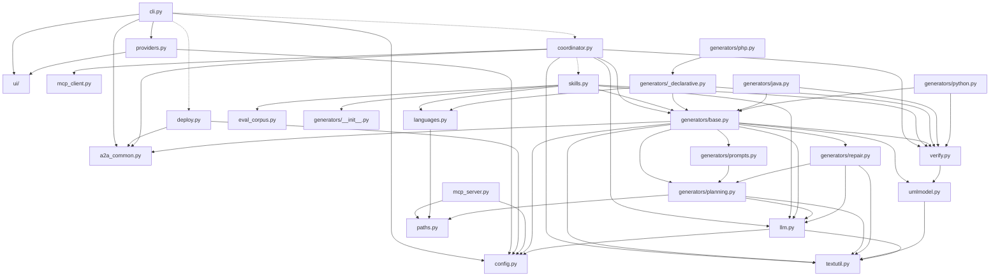

# Architecture

Ce document décrit le rôle de chaque module du paquet `umlfactory/`, leurs dépendances, et les composants qui tournent pendant une génération.

## Vue d'ensemble

Le paquet compte quatre grandes parties :

- **l'interface** : `cli.py` et le package `ui/` (questions, menus, progression) ;
- **la pile** : `deploy.py` (démarrage et arrêt), `mcp_server.py` et `mcp_client.py` (accès aux fichiers), `coordinator.py` (orchestration) ;
- **les agents** : `generators/` (un fichier par langage, plus le code commun) ;
- **le socle** : `config.py`, `llm.py`, `providers.py`, `a2a_common.py`, `verify.py`, `umlmodel.py`, `languages.py`, `skills.py`, `paths.py`, `textutil.py`, `eval_corpus.py`.

## Tableau des modules

### Interface et pile

| Fichier | Rôle | Éléments principaux |
|---|---|---|
| `umlfactory/__init__.py` | Version du paquet (`__version__ = "0.1.0"`) | aucun |
| `umlfactory/cli.py` | Point d'entrée utilisateur : options, questions, progression, `--keep-running`, `--stop` | `main()`, `build_parser()`, `run()`, `connect()`, `list_languages()`, `call_steps()`, `add_language()`, `conformity_lines()`, `count_files()`, `stack_needed()`, `stop_command()`, `log_crash()`, `FriendlyParser`, `CliError` |
| `umlfactory/deploy.py` | Démarre et arrête la pile : serveur MCP, coordinateur, un agent par langage | `Component`, `plan_components()`, `running_stack()` (gestionnaire de contexte), `is_ready()`, `stop_stack()`, `write_state()`, `read_state()`, `language_modules()`, `main()` |
| `umlfactory/coordinator.py` | Agent coordinateur (A2A) : lecture du `.puml`, délégation, écriture des fichiers, gestion des langages | `Coordinator` (sous-classe de `AgentExecutor`), `CoordinatorRequest`, `pick_destination()`, `index_languages()`, `_InProcessServer` |
| `umlfactory/mcp_server.py` | Serveur MCP : outils `read_puml` et `write_sources` | `build_server()`, `read_puml_file()`, `write_source_files()`, `main()`, `PumlDocument`, `SourceFile`, `WriteReport` |
| `umlfactory/mcp_client.py` | Appels aux outils MCP depuis le coordinateur | `read_puml()`, `write_sources()`, `McpToolError` |
| `umlfactory/a2a_common.py` | Briques A2A partagées : serveur d'agent, découverte, appel avec événements | `build_app()`, `serve_agent()`, `run_cli()`, `send_event()`, `discover()`, `discover_local()`, `call_agent()`, `free_port()`, `DiscoveredAgent`, `AgentReply`, `AgentFailed` |

### Modèle, configuration et vérification

| Fichier | Rôle | Éléments principaux |
|---|---|---|
| `umlfactory/config.py` | Lecture du `.env`, réglages, fournisseurs | `Settings`, `Candidate`, `load_settings()`, `load_env_file()`, `parse_env_file()`, `candidates()`, `local_candidate()`, `infer_provider()`, `api_base()`, `anthropic_root()`, `mask_key()`, `describe()`, `ConfigError`, constantes (`VERIFY_BUDGET = 10.0`, `DEFAULT_PORT_RANGE`, etc.) |
| `umlfactory/llm.py` | Client unique des API de modèles (OpenAI compatible et Anthropic), avec streaming et nouvelles tentatives | `LLMClient` (`chat()`, `_payload()`, `_stream()`, `_once()`, `_check_status()`, `_text()`, `_final()`, `_anthropic_event()`), `LLMError` |
| `umlfactory/providers.py` | Test des clés et choix du fournisseur au lancement | `resolve()`, `probe_all()`, `choose()`, `apply()`, `saved_provider()`, `save_provider()`, `PREFS_FILE` |
| `umlfactory/umlmodel.py` | Lecture minimale du PlantUML, pour contrôler le code (ne génère rien) | `parse()`, `Model`, `UmlClass`, `UmlRelation`, `norm()` |
| `umlfactory/verify.py` | Contrôle local du code : outils, exécution contrôlée, scan des appels sensibles, comparaison des noms, score | `Runtime` (classe abstraite), `VerifyContext`, `VerifyReport`, `Tracker`, `Finding`, `run()`, `clean_env()`, `find_tool()`, `missing_tools()`, `scan_sensitive()`, `parse_findings()`, `name_findings()`, `findings_to_report()`, `compute_score()`, `write_tree()` |
| `umlfactory/textutil.py` | Nettoyage des réponses du modèle : blocs `<think>`, blocs de code, JSON, notes PlantUML | `strip_think()`, `extract_code()`, `extract_json()`, `declared_names()`, `strip_notes()` |
| `umlfactory/paths.py` | Chemins relatifs sûrs (un nom de fichier venant du modèle n'est jamais une donnée de confiance) | `safe_relative_path()`, `UnsafePathError` |

### Langages ajoutés et skills du coordinateur

| Fichier | Rôle | Éléments principaux |
|---|---|---|
| `umlfactory/languages.py` | Spécification d'un langage ajouté (données), règles de sécurité, brouillons, génération du fichier d'agent | `LanguageSpec`, `ALLOWED_TOOLS`, `VALIDATED_MIN`, `safety_problems()`, `sanitize_id()`, `save_spec()`, `load_spec()`, `delete_spec()`, `render_generator()`, `export_generator()`, `is_generated()`, `delete_generated()`, `forbidden_generated()` |
| `umlfactory/skills.py` | Trois compétences du coordinateur : créer, vérifier les outils, valider un langage | `create_language()`, `check_language()`, `validate_language()`, `discard_language()`, `build_agent()`, `tool_report()`, `SkillError` |
| `umlfactory/eval_corpus.py` | Six diagrammes de référence pour valider un agent (trois en validation rapide) | `CORPUS`, `Reference`, `select()` |

### Agents de langage (`umlfactory/generators/`)

| Fichier | Rôle | Éléments principaux |
|---|---|---|
| `generators/__init__.py` | Liste des langages intégrés et recherche de la classe d'agent | `built_in_ids()`, `agent_class()`, `SUPPORT_MODULES` |
| `generators/__main__.py` | Lance l'agent d'un langage : `python -m umlfactory.generators <langage> --port N` | `build_agent()`, `main()` |
| `generators/base.py` | Pipeline commun à tous les agents : planifier, écrire, contrôler, corriger, juger, répondre en A2A | `BaseGeneratorAgent`, `GenerationResult`, `REPORT_ARTIFACT` |
| `generators/planning.py` | Requête de génération, plan de fichiers, suivi de progression du modèle | `GenerationRequest`, `PlannedFile`, `PlanningMixin` (`_plan()`, `_parse_plan()`, `normalize_path()`), `_Tracker` |
| `generators/prompts.py` | Messages envoyés au modèle | `PromptsMixin` (`system_prompt()`, `_plan_messages()`, `_file_messages()`, `_repair_messages()`), `CONVERSION_RULES`, `repair_hint()` |
| `generators/repair.py` | Contrôles communs et verdict de conformité | `RepairMixin` (`_check()`), `judge_conformity()`, `JUDGE_SYSTEM`, `Validation`, `unverified()`, `MAX_REPAIRS = 2` |
| `generators/_declarative.py` | Agent défini par des attributs seulement (PHP, langages ajoutés) | `CommandRuntime`, `CommandGenerator`, `DeclarativeGenerator`, `expand_command()` |
| `generators/java.py` | Agent Java : règles de style, vérifications statiques, `javac` et harnais Java | `JavaGenerator`, `JavaRuntime`, `balanced()`, `_HARNESS` |
| `generators/python.py` | Agent Python : analyse `ast`, imports circulaires, harnais Python | `PythonGenerator`, `PythonRuntime`, `runtime_imports()`, `find_cycle()`, `_HARNESS` |
| `generators/php.py` | Agent PHP, déclaratif : `php -l` et règles de conformité | `PhpGenerator` |

Le fichier `_declarative.py` commence par `_` : `generators/__init__.py` ne le compte donc pas comme langage. Les modules `base`, `planning`, `prompts` et `repair` sont exclus par la liste `SUPPORT_MODULES`.

### Interface terminal (`umlfactory/ui/`)

| Fichier | Rôle | Éléments principaux |
|---|---|---|
| `ui/__init__.py` | Réexporte les éléments utiles aux autres modules | voir [03-cli-et-affichage.md](03-cli-et-affichage.md) |
| `ui/term.py` | Couleurs, largeurs d'affichage, formats de durée et de taille | `Term`, `fmt_time()`, `fmt_size()`, `fmt_seconds()`, `fit()`, `char_width()`, `text_width()`, `clean()` |
| `ui/progress.py` | Affichage de la progression : génération, étapes, ligne d'attente | `LiveView`, `StepView`, `StatusLine`, `FileView`, `LangView`, `StepRow`, `fit_ansi()`, `SPIN` |
| `ui/prompts.py` | Questions et menus au clavier | `select()`, `ask()`, `confirm()`, `choose_languages()`, `choose_puml()`, `run_steps()`, `read_key()`, `raw_mode()`, `BackGuard`, `GoBack` |

## Dépendances entre modules

Les flèches pleines sont des imports au chargement du module ; les flèches pointillées sont des imports faits dans une fonction (import tardif).

Deux conséquences visibles sur ce schéma :

- `verify.py` ne dépend d'aucun module A2A ni MCP : son commentaire d'en-tête indique qu'il peut être testé seul.
- Les agents n'importent jamais le coordinateur. Le coordinateur, lui, ne connaît aucun langage : il découvre les agents par leur carte A2A (tags `codegen:<langage>`).

## Composants pendant une génération

| Composant | Commande lancée par la pile | Adresse par défaut | Journal |
|---|---|---|---|
| Serveur MCP | `python -m umlfactory.mcp_server` | `http://127.0.0.1:9000/mcp` (variable `MCP_URL`) | `logs/mcp.log` |
| Coordinateur | `python -m umlfactory.coordinator` | `http://127.0.0.1:9200` (variable `COORDINATOR_URL`) | `logs/coordinator.log` |
| Agent Java | `python -m umlfactory.generators java --port N` | premier port libre de `9101-9150` | `logs/java.log` |
| Agent Python | `python -m umlfactory.generators python --port N` | premier port libre de `9101-9150` | `logs/python.log` |
| Agent PHP | `python -m umlfactory.generators php --port N` | premier port libre de `9101-9150` | `logs/php.log` |

Les noms des journaux viennent de `deploy.running_stack` : `logs / f"{c.name}.log"`, où `c.name` est `mcp`, `coordinator` ou l'identifiant du langage.

La pile n'écoute que sur `127.0.0.1` : `mcp_server.main()` et `a2a_common.run_cli()` ont `--host 127.0.0.1` par défaut, et `a2a_common.discover()` ignore les proxys de l'environnement (`trust_env=False`).

## Protocoles

### A2A (CLI vers coordinateur, coordinateur vers agents)

- Chaque agent est un serveur Starlette (`a2a_common.build_app`) qui publie sa carte à `/.well-known/agent-card.json` et reçoit les requêtes JSON-RPC à la racine `/`.
- La carte contient des compétences (`AgentSkill`) et des tags. Le tag `codegen:<langage>` indique qu'un agent sait générer ce langage. Les tags `verify:<langage>` et `tool:<exécutable>` décrivent la vérification d'exécution.
- Une requête est un message dont la partie principale est un objet JSON (`DataPart`), par exemple `{"action": "list_languages"}` ou `{"puml": "...", "package": "..."}`.
- Pendant le travail, l'agent publie des mises à jour d'état `WORKING` dont le message contient un objet JSON d'événement (`a2a_common.send_event`). Le client les relaie (`a2a_common.call_agent`, paramètre `on_event`).
- Les fichiers générés sont renvoyés comme artefacts, un par fichier, nommé par son chemin relatif. Le rapport est l'artefact `_report.json` (agents) ou `report.json` (coordinateur).

### MCP (coordinateur vers serveur MCP)

- Le serveur MCP (`mcp_server.build_server`) s'appelle `umlfactory-files` et expose en Streamable HTTP (`/mcp`) deux outils :
  - `read_puml(path)` : renvoie `{"path", "text"}` ; accepte seulement les extensions `.puml`, `.plantuml`, `.pu`, `.uml`, un fichier d'au plus 1 Mo, contenant `@startuml`.
  - `write_sources(dest_dir, files, overwrite)` : écrit des fichiers relatifs dans `dest_dir`.
- Le client (`mcp_client._call`) ouvre une connexion pour chaque appel et lit `structured_content`.

## Où sont les données de configuration

Toutes les variables sont lues dans `config.py`, qui est la source unique. Le détail des variables est dans [05-llm-et-agents.md](05-llm-et-agents.md#configuration-et-variables-denvironnement).
