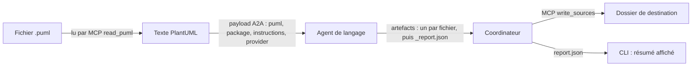

# Flux de données : du `.puml` au code généré

Ce document suit les données étape par étape : ce que la CLI envoie, ce que le coordinateur fait, ce que l'agent produit, et ce qui revient à l'utilisateur. Il décrit aussi les structures Python et les formats d'événements.

## 1. Vue d'ensemble



Le diagramme n'est jamais transformé en modèle intermédiaire qui servirait à générer le code. Le code est écrit par le modèle, fichier par fichier, à partir du texte PlantUML. Le module `umlmodel.py` lit le diagramme seulement pour contrôler le résultat.

## 2. Étape 1 : la CLI prépare la demande

Dans `cli.run()`, la CLI rassemble :

| Donnée | Origine | Exemple |
|---|---|---|
| `model_path` | argument ou question (`step_file`), résolu en chemin absolu | `C:\...\examples\model.puml` |
| `languages` | `--lang` ou menu (`step_languages`), en minuscules | `["java", "python"]` |
| `out_dir` | `-o` ou question (`step_destination`), résolu | `C:\...\sortie` |
| `layout` | `--layout` (défaut `auto`) | `"auto"` |
| `package`, `instructions`, `request` | options `--package`, `--instructions`, `--ask` | `"com.exemple.banque"` |
| `overwrite` | `--overwrite`, `-y` ou confirmation | `false` |
| `provider` | `providers.resolve()` | `"anthropic"` |

Elle envoie ensuite au coordinateur un objet JSON de cette forme (les clés sont celles construites dans `cli.run`) :

```json
{
  "puml_path": "<chemin absolu du .puml>",
  "output_dir": "<chemin absolu du dossier de destination>",
  "layout": "auto",
  "provider": "anthropic",
  "languages": ["java"],
  "package": "com.exemple.banque",
  "instructions": "ajoute des javadoc",
  "overwrite": false
}
```

Les clés `package`, `instructions`, `request` ne sont présentes que si elles ont été données.

Avant l'envoi, la CLI vérifie les dossiers déjà remplis : elle calcule les dossiers de chaque langage avec `coordinator.pick_destination` puis compte les fichiers (`count_files`).

## 3. Étape 2 : le coordinateur valide et lit le diagramme

`Coordinator.execute()` reçoit le message A2A, puis :

1. `CoordinatorRequest.model_validate(data[0])` valide les champs. `puml_path` et `output_dir` doivent être absolus (`_absolute`), et il faut exactement un de `puml_path` ou `puml_text` (`Coordinator.run`).
2. `load_settings(...)` charge la configuration. Pour une génération avec `languages`, l'API n'est pas exigée au niveau du coordinateur ; elle l'est pour les agents. Avec une demande libre (`request`) sans `languages`, elle est exigée tout de suite, car le modèle doit choisir le langage.
3. `Coordinator.run()` lit le fichier : `mcp_client.read_puml(settings.mcp_url, req.puml_path)`, qui renvoie le texte.
4. `Coordinator.available()` découvre les agents joignables (`a2a_common.discover_local`, plage `GENERATOR_PORT_RANGE`). `index_languages()` associe chaque langage à un agent. Un langage inconnu fait échouer la demande.
5. Les langages demandés sont validés. Si `layout` vaut `flat` avec plusieurs langages, la demande est refusée, sauf si `outputs` précise un dossier par langage.

Le coordinateur n'a aucune liste de langages codée en dur : la liste vient des cartes des agents (`index_languages`, tags `codegen:<langage>`).

## 4. Étape 3 : l'agent reçoit la demande

Pour chaque langage, le coordinateur envoie à l'agent un message `payload` construit ainsi :

```python
payload = {k: v for k, v in {
    "puml": puml,               # texte du diagramme
    "package": req.package,
    "instructions": req.instructions,
    "provider": settings.provider,
}.items() if v}
```

Dans l'agent, `BaseGeneratorAgent.read_request()` transforme ce message en `GenerationRequest` (`generators/planning.py`). Les contraintes sont : `puml` entre 10 et 200 000 caractères, `package` au format `a.b.c` (lettres, chiffres et `_`), `instructions` de 2 000 caractères au plus, `provider` égal à `openai` ou `anthropic`. Une requête invalide fait échouer la tâche avec le message « requête invalide ».

L'agent appelle ensuite `generate()` (détaillé dans [04-generation-par-langage.md](04-generation-par-langage.md)), qui produit un `GenerationResult`.

## 5. Étape 4 : l'agent renvoie les fichiers

`BaseGeneratorAgent.execute()` publie :

- un artefact par fichier généré, nommé par son chemin relatif (par exemple `com/exemple/banque/CompteBancaire.java`), avec les métadonnées `language` et `path` ;
- un artefact réservé `_report.json` (constante `REPORT_ARTIFACT`) :

```json
{
  "warnings": ["..."],
  "model": "<nom du modèle>",
  "verification": {
    "score": 100,
    "seconds": 2.31,
    "skipped": "",
    "details": ["..."],
    "steps": [{"name": "compilation (javac)", "seconds": 0.8, "ok": true, "detail": ""}],
    "conformity": {"verdict": "conforme", "missing": [], "summary": "...", "reason": "..."}
  }
}
```

Le champ `score` reste interne : la CLI ne l'affiche jamais (voir [03-cli-et-affichage.md](03-cli-et-affichage.md)). Le champ `conformity` est le seul utilisé pour l'affichage du verdict. Le champ `reason` n'apparaît que pour un verdict `non_verifie`, et `not_run` seulement si la compilation ou l'exécution n'a pas pu avoir lieu.

Le message final est un texte du type « 5 fichier(s) Java généré(s) » ; la tâche passe à l'état terminé.

## 6. Étape 5 : le coordinateur écrit les fichiers

Pour chaque langage, le coordinateur :

1. retire `_report.json` des artefacts pour obtenir les fichiers (`files`) ;
2. lit les avertissements (`warnings`) ;
3. calcule le dossier de destination avec `pick_destination(req, language, wanted)` ;
4. appelle `mcp_client.write_sources(settings.mcp_url, dest, files, req.overwrite)`.

Le serveur MCP (`mcp_server.write_source_files`) contrôle avant toute écriture :

- la liste de fichiers n'est pas vide, et la destination, si elle existe, est un dossier ;
- au plus 2 000 fichiers, 2 Mo par fichier ;
- chaque chemin passe `paths.safe_relative_path` (pas de `..`, pas de chemin absolu, pas de caractères Windows interdits, pas de noms réservés) ;
- pas de doublon ;
- aucun chemin ne sort du dossier de destination ;
- aucun fichier existant au contenu différent, sauf si `overwrite` est vrai.

Si un contrôle échoue, rien n'est écrit et l'erreur remonte au coordinateur (`McpToolError`), qui la range dans `report["failed"]`.

### Destination selon le layout

`pick_destination()` (dans `coordinator.py`) applique cette règle :

1. si `outputs[langage]` est fourni, ce dossier est utilisé ;
2. sinon, avec `layout` = `auto`, un seul langage écrit directement dans le dossier de sortie (`flat`), et plusieurs langages écrivent chacun dans `<sortie>/<langage>` (`by-language`) ;
3. `flat` écrit dans le dossier de sortie ; `by-language` écrit toujours dans `<sortie>/<langage>`.

## 7. Étape 6 : la CLI affiche le résultat

La CLI reçoit `report.json` :

```json
{
  "languages": {
    "java": {
      "agent": "generateur-java",
      "dest": "C:\\...\\sortie",
      "files": ["BankAccount.java", "..."],
      "warnings": [],
      "verification": {"conformity": {"verdict": "conforme", "missing": [], "summary": "..."}}
    }
  },
  "failed": {}
}
```

Pour chaque langage réussi, la CLI affiche le nombre de fichiers, le chemin, le verdict (`cli.conformity_lines`) et jusqu'à trois avertissements. Les langages en échec sont listés sur la sortie d'erreur. Le code de sortie vaut `1` si `failed` n'est pas vide.

## 8. Événements de progression

Pendant le travail, les composants envoient des événements. Ce sont des objets JSON transportés dans des messages A2A de mise à jour d'état `WORKING` (`a2a_common.send_event`). `a2a_common.call_agent` les transmet à la fonction `on_event`. Le coordinateur les relaie en ajoutant le champ `lang` (`Coordinator.run`, fonction `relay`).

| Événement | Émis par | Champs | Usage dans la CLI |
|---|---|---|---|
| `phase` | agent et coordinateur | `text`, `lang` (optionnel) | titre de l'étape en cours |
| `plan` | agent | `files` (liste de chemins) | crée une ligne par fichier |
| `file` | agent | `path`, `state` (`start`, `thinking`, `writing`, `done`, `error`, `fix`), `chars`, `thought`, `preview`, `detail`, `fix` | état de chaque fichier |
| `verify` | agent | `state` (`slow` ou `done`), `step`, `score`, `seconds`, `skipped` | étape lente de vérification, puis résultat |
| `written` | coordinateur | `lang`, `count`, `dest` | fichiers écrits |
| `step` | skills du coordinateur | `id`, `text`, `state` (`start`, `done`, `warn`, `fail`), `detail` | étapes de création ou de validation d'un langage |

Les événements `file` et `phase` émis pendant le streaming du modèle reflètent le texte reçu : la classe `_Tracker` (dans `generators/planning.py`) compte les caractères, distingue la réflexion (`<think>` ou `reasoning`) de l'écriture, et ne publie qu'environ quatre événements par seconde.

## 9. Formats intermédiaires des vérifications

Ces fichiers n'existent que dans un dossier temporaire, pendant la vérification.

### Fichier d'attentes pour Java (`expect.txt`)

Généré par `java._expectations()`. Chaque ligne est séparée par des tabulations :

| Ligne | Forme | Sens |
|---|---|---|
| `C` | `C\t<Nom>\t<nom qualifié>\t<genre>` | une classe du diagramme et son type attendu |
| `X` | `X\t<enfant>\t<parent>` | héritage ou réalisation |
| `A` | `A\t<classe>\t<attribut>` | attribut attendu |
| `O` | `O\t<classe>\t<opération>` | opération attendue (pas pour les énumérations) |
| `R` | `R\t<source>\t<cible>\t<plusieurs>\t<bidirectionnelle>` | relation attendue |

### Fichier de spécification pour Python (`spec.json`)

Généré par `PythonRuntime.check()`. Exemple de forme (les valeurs sont illustratives) :

```json
{
  "modules": ["wallet", "i_pay", "card"],
  "classes": [{"name": "Wallet", "kind": "abstract"}],
  "extends": [["Card", "Wallet"]],
  "attrs": [["Wallet", "amount"]],
  "ops": [["Wallet", "addMoney"]],
  "rels": [["Card", "Wallet", true, false]]
}
```

### Lignes de résultat du harnais

Les deux harnais (Java et Python) impriment une ligne par constat, au format :

```
@@UMLFACTORY@@<NIVEAU>|<genre>|<classe>|<message>
```

`NIVEAU` vaut `OK`, `FAIL`, `SKIP` ou `SOFT`. `verify.parse_findings()` lit ces lignes et crée des `Finding`. Les constats `FAIL` deviennent des erreurs attribuées au fichier qui définit la classe ; les constats `SOFT` deviennent des remarques.

## 10. Structures de données principales

### Côté coordinateur et CLI

| Structure | Module | Champs importants |
|---|---|---|
| `CoordinatorRequest` (Pydantic) | `coordinator.py` | `action`, `puml_path`, `puml_text`, `output_dir`, `languages`, `request`, `outputs`, `layout`, `package`, `instructions`, `overwrite`, `language_name`, `language_id`, `approve`, `provider`, `quick` |
| `DiscoveredAgent` | `a2a_common.py` | `url`, `card` ; méthodes `languages()`, `runtime_tools()`, `display_name()` |
| `AgentReply` | `a2a_common.py` | `state`, `text`, `artifacts` (dictionnaire nom vers contenu) |
| `Candidate` | `config.py` | `provider`, `key`, `url`, `model` |
| `Settings` | `config.py` | `api_url`, `api_key`, `model`, `timeout`, `concurrency`, `temperature`, `max_tokens`, `extra`, `provider`, `mcp_url`, `coordinator_url`, `generator_ports`, `generator_urls`, `verify_budget`, `thinking`, `reasoning_effort` |

### Côté agent

| Structure | Module | Champs importants |
|---|---|---|
| `GenerationRequest` (Pydantic) | `generators/planning.py` | `puml`, `package`, `instructions`, `provider` |
| `PlannedFile` (dataclasse gelée) | `generators/planning.py` | `path`, `elements` (noms UML définis dans le fichier), `summary` |
| `GenerationResult` | `generators/base.py` | `files` (chemin vers contenu), `warnings`, `verification` |
| `Validation` | `generators/repair.py` | `errors` (chemin vers problème), `notes` |
| `VerifyContext` | `verify.py` | `files`, `model`, `class_files` (nom UML vers chemin), `tracker`, `package` |
| `VerifyReport` | `verify.py` | `score` (`None` si non exécuté), `errors`, `notes`, `steps`, `seconds`, `skipped`, `details` |
| `Finding` | `verify.py` | `level`, `kind` (`import`, `init`, `class`, `extends`, `attr`, `op`, `rel`), `cls`, `msg` |
| `Model`, `UmlClass`, `UmlRelation` | `umlmodel.py` | voir ci-dessous |

Le modèle lu par `umlmodel.parse()` :

- `Model` : `classes` (dictionnaire nom vers `UmlClass`), `extends` (liste de couples enfant, parent), `implements` (même forme), `relations` (liste de `UmlRelation`).
- `UmlClass` : `name`, `kind` (`class`, `abstract`, `interface`, `enum`), `attributes`, `operations`. Pour une énumération, `attributes` contient les constantes.
- `UmlRelation` : `source`, `target`, `many` (vrai si la cardinalité maximale est supérieure à 1), `both` (association sans sens de navigation).

### Côté langages ajoutés

| Structure | Module | Champs importants |
|---|---|---|
| `LanguageSpec` (Pydantic) | `languages.py` | `id`, `display_name`, `file_extensions`, `source_media_type`, `plan_rules`, `style_rules`, `tools`, `build`, `scaffold`, `sensitive_calls`, `conformity_rules`, `status` (`draft`, `experimental`, `validated`), `approved`, `score`, `install_guide` |

## 11. Où vivent les données pendant la génération

| Donnée | Lieu | Durée |
|---|---|---|
| texte du `.puml` | mémoire du coordinateur et de l'agent | le temps de la génération |
| fichiers générés | dictionnaire `files` de `BaseGeneratorAgent.generate` | le temps de la génération, puis artefacts A2A |
| code vérifié | dossier temporaire `umlfactory-java-*`, `umlfactory-py-*` ou `umlfactory-lang-*` | supprimé à la fin de la vérification |
| verdict et rapport | `report.json` puis affichage | non conservés |
| brouillon de langage | `umlfactory/.drafts/<id>.json` | supprimé à la validation ou à l'abandon |
