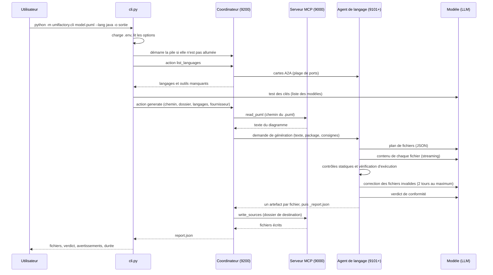
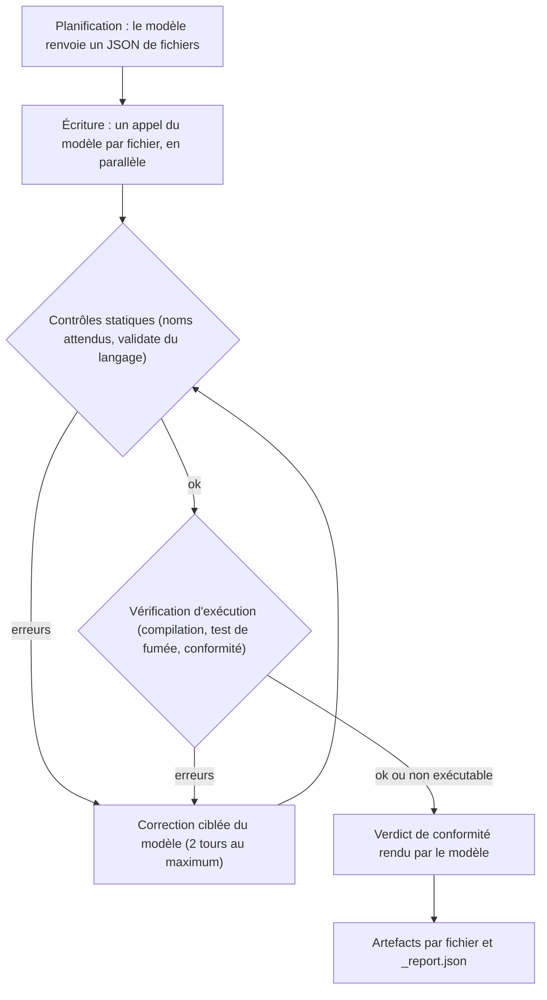

# UML Factory : fonctionnement de bout en bout

Ce document décrit ce que fait réellement le code du dépôt `umlfactory-llm`, du fichier PlantUML (`.puml`) jusqu'au code source généré et à son verdict de conformité. Chaque affirmation renvoie au fichier et à la fonction concernés.

Les autres fichiers de cette série détaillent chaque partie :

| Fichier | Contenu |
|---|---|
| [01-architecture.md](01-architecture.md) | Rôle de chaque module, dépendances, composants et ports |
| [02-flux-de-donnees.md](02-flux-de-donnees.md) | Étapes du `.puml` au code, structures de données, événements |
| [03-cli-et-affichage.md](03-cli-et-affichage.md) | Commandes, options, sorties, package `ui/` |
| [04-generation-par-langage.md](04-generation-par-langage.md) | Java, Python, PHP, langages déclaratifs, planification, correction, vérification |
| [05-llm-et-agents.md](05-llm-et-agents.md) | LLM, fournisseurs, prompts, coordinateur, A2A, MCP, skills, variables `.env` |
| [06-tests.md](06-tests.md) | Ce que couvre chaque fichier de test, et comment les lancer |
| [07-exemples.md](07-exemples.md) | Exemples d'utilisation réalistes |

## En une phrase

Un serveur MCP lit le fichier `.puml`, un coordinateur répartit le travail entre des agents (un agent par langage), chaque agent demande au modèle un plan de fichiers puis le contenu de chaque fichier, vérifie le résultat sur la machine, renvoie les erreurs au modèle pour correction (deux tours au maximum), puis le modèle rend un verdict de conformité au diagramme. Le coordinateur écrit ensuite les fichiers par MCP, et la CLI affiche la progression en direct.

## Les acteurs

| Acteur | Fichier principal | Port par défaut | Rôle |
|---|---|---|---|
| CLI | `umlfactory/cli.py` | aucun (client) | Pose les questions, affiche la progression, lance la pile si besoin |
| Serveur MCP | `umlfactory/mcp_server.py` | 9000 | Lit le `.puml`, écrit les fichiers générés. Ne comprend pas l'UML. |
| Coordinateur | `umlfactory/coordinator.py` | 9200 | Choisit les langages, délègue aux agents, écrit les fichiers, gère l'ajout de langages |
| Agents de langage | `umlfactory/generators/<langage>.py` | 9101 à 9150 | Un agent par langage : planifie, écrit, vérifie et corrige le code |
| Modèle (LLM) | `umlfactory/llm.py` | distant (OpenAI, Anthropic ou compatible) | Écrit le plan, le code, les corrections et le verdict |

Les protocoles sont les suivants : A2A (JSON-RPC sur HTTP) entre la CLI, le coordinateur et les agents, et MCP (Streamable HTTP) entre le coordinateur et le serveur MCP. Le détail est dans [05-llm-et-agents.md](05-llm-et-agents.md).

## Déroulement pas à pas

1. **Lancement.** `python -m umlfactory.cli` exécute `main()` dans `cli.py`. Le fichier `.env` est chargé (`config.load_env_file`), les options sont lues (`build_parser`), puis les réglages sont chargés (`config.load_settings`).
2. **Pile.** Si le coordinateur configuré est local et ne répond pas, `cli.stack_needed` renvoie vrai et `deploy.running_stack` lance le serveur MCP, le coordinateur, puis un agent pour chaque module de `generators/` qui n'est pas déjà servi. Les journaux vont dans `logs/`.
3. **Découverte.** La CLI récupère la carte A2A du coordinateur (`cli.connect`), puis demande la liste des langages (`cli.list_languages`). Le coordinateur interroge les agents présents sur la plage de ports (`a2a_common.discover_local`).
4. **Fournisseur.** `providers.resolve` teste chaque clé présente (une requête de liste de modèles). Si deux clés sont valides et que la session est interactive, l'utilisateur choisit ; le choix est mémorisé dans `.umlfactory.json`.
5. **Questions.** Fichier `.puml`, langage(s), dossier de destination, sauf si elles sont données en options (`ui.run_steps`).
6. **Dossier cible.** `cli.count_files` compte les fichiers déjà présents. S'il y en a, la CLI demande confirmation (ou échoue sans `--overwrite` en mode non interactif).
7. **Génération.** La CLI envoie au coordinateur une demande `generate` (`cli.run` puis `cli.call_agent`). Pendant le travail, les événements de progression reviennent et sont affichés par `ui.LiveView`.
8. **Lecture.** Le coordinateur lit le `.puml` par MCP (`mcp_client.read_puml`, outil `read_puml`).
9. **Travail des agents.** Chaque langage demandé est traité en parallèle (`asyncio.gather` dans `Coordinator.run`). Pour chaque langage, l'agent :
   - demande un plan de fichiers au modèle (`PlanningMixin._plan`) ;
   - demande chaque fichier au modèle, en parallèle (`BaseGeneratorAgent.generate`) ;
   - contrôle les fichiers (`RepairMixin._check`, puis `runtime.check`) ;
   - renvoie au modèle les fichiers invalides pour correction, deux tours au maximum ;
   - demande au modèle un verdict de conformité (`repair.judge_conformity`).
10. **Écriture.** Le coordinateur écrit les fichiers reçus dans le dossier de destination par MCP (`mcp_client.write_sources`, outil `write_sources`). Les conflits avec des fichiers existants font échouer l'écriture, sauf avec `overwrite`.
11. **Résultat.** Le coordinateur renvoie un `report.json` ; la CLI affiche, par langage, le nombre de fichiers, le verdict de conformité, les avertissements et la durée totale.
12. **Arrêt.** Sauf avec `--keep-running`, la pile démarrée par la CLI est arrêtée à la fin (`running_stack`, dans le bloc `finally`).

## Séquence complète

Pendant les étapes 9 et 10, l'agent et le coordinateur envoient aussi des événements de progression (`{"event": "file", ...}`, `{"event": "phase", ...}`, etc.) qui sont relayés jusqu'à la CLI. Le format est décrit dans [02-flux-de-donnees.md](02-flux-de-donnees.md).

## Vue par étapes de la génération d'un langage

Les erreurs résiduelles après les deux tours de correction ne bloquent pas la génération : elles sont signalées en avertissements, et empêchent seulement un verdict « conforme ».

## Fichiers lus ou créés par le programme

| Chemin | Créé ou lu par | Contenu |
|---|---|---|
| `.env` | lu par `config.load_env_file` | Clés d'API et réglages (jamais affichés en entier) |
| `.umlfactory.json` | écrit par `providers.save_provider` | Fournisseur mémorisé, par exemple `{"provider": "anthropic"}` |
| `.umlfactory-stack.json` | écrit par `deploy.write_state` (option `--keep-running`) | Processus de la pile laissée allumée |
| `logs/<composant>.log` | écrit par `deploy.running_stack` | Sortie de chaque composant de la pile |
| `logs/erreur.log` | écrit par `cli.log_crash` | Trace complète d'une erreur inattendue |
| `umlfactory/.drafts/` | écrit par `languages.save_spec` et `skills` | Brouillons de langages ajoutés (JSON et guides d'installation) |
| `umlfactory/generators/<langage>.py` | écrit par `languages.export_generator` | Agent d'un langage ajouté |
| dossier de destination (`sortie/` par défaut) | écrit par le serveur MCP (`mcp_server.write_source_files`) | Code généré |
| dossier temporaire | créé et supprimé par `verify.py` et les runtimes | Copie du code pour compilation et test, jamais dans le projet |
