# Les diagrammes du projet UmlFactory

---

## Sommaire

1. [Vue d'ensemble du SMA](#1-vue-densemble-du-sma)
2. [Diagramme de composants](#2-diagramme-de-composants)
3. [Diagramme de déploiement](#3-diagramme-de-déploiement)
4. [Diagramme de paquetages](#4-diagramme-de-paquetages)
5. [Diagramme de classes](#5-diagramme-de-classes)
6. [Diagramme d'objets](#6-diagramme-dobjets)
7. [Diagramme de cas d'utilisation](#7-diagramme-de-cas-dutilisation)
8. [Diagramme de séquence — génération nominale](#8-diagramme-de-séquence--génération-nominale)
9. [Diagramme de séquence — vérification et verdict](#9-diagramme-de-séquence--vérification-et-verdict)
10. [Diagramme de séquence — ajout d'un langage](#10-diagramme-de-séquence--ajout-dun-langage)
11. [Diagramme de communication](#11-diagramme-de-communication)
12. [Diagramme d'activité — ajout d'un langage](#12-diagramme-dactivité--ajout-dun-langage)
13. [Diagramme d'états — fichier généré](#13-diagramme-détats--fichier-généré)
14. [Diagramme d'états — la pile](#14-diagramme-détats--la-pile)
15. [Diagramme d'états — verdict de conformité](#15-diagramme-détats--verdict-de-conformité)
16. [Chronologie d'une exécution](#16-chronologie-dune-exécution)
17. [Carte mentale de l'architecture](#17-carte-mentale-de-larchitecture)

---

## 1. Vue d'ensemble du SMA

La CLI (`python -m umlfactory.cli`) allume la pile, délègue au coordinateur (A2A), qui lit le `.puml` via le serveur MCP et fait écrire le code par les agents de langage, eux-mêmes clients de l'API du modèle d'IA.

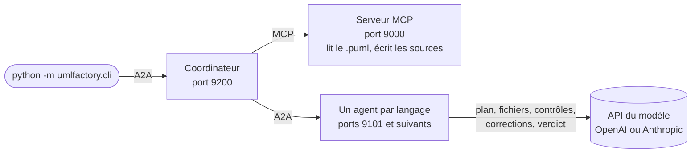

**Explication** : aucun gabarit ni regex pour générer : le modèle d'IA écrit un plan de fichiers puis chaque fichier. La fiabilité vient d'une boucle de contrôle (compilation, comparaison des noms avec le diagramme, correction, verdict).

---

## 2. Diagramme de composants

**Explication** : vue logique. La CLI orchestre ; le coordinateur répartit le travail et gère les langages ; le serveur MCP est la seule porte d'entrée/sortie des fichiers ; chaque agent de langage encapsule les prompts et la vérification de son langage. Les agents sont interchangeables : ajouter un langage = ajouter un fichier dans `umlfactory/generators/`, sans toucher au noyau.

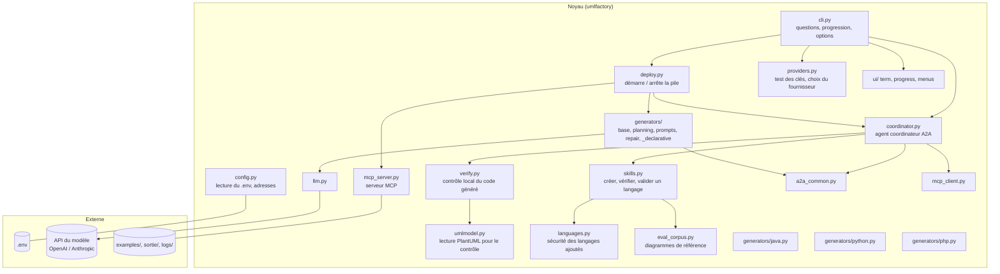

---

## 3. Diagramme de déploiement

**Explication** : vue physique. Tout tourne sur le poste de l'utilisateur, sur `127.0.0.1` uniquement. La CLI démarre les trois familles de processus (ou réutilise une pile déjà allumée via `.umlfactory-stack.json`), et les agents de langage appellent l'API du modèle d'IA sur Internet. Les journaux vont dans `logs/`.

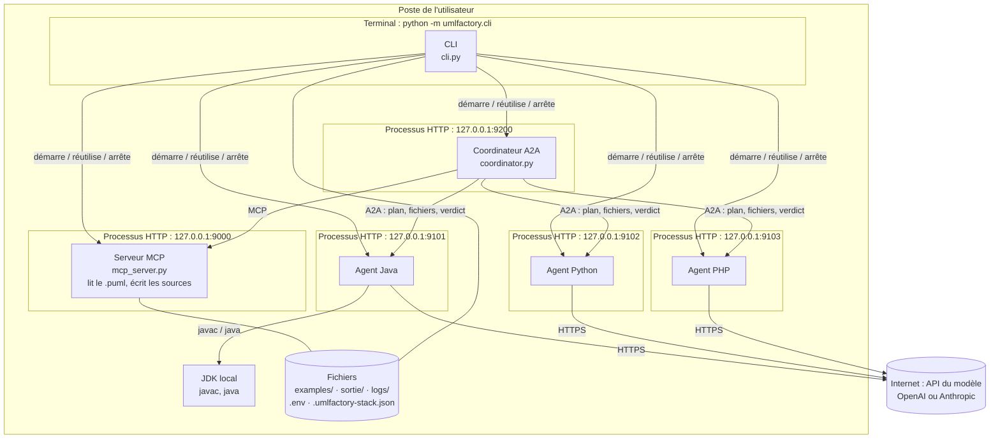

---

## 4. Diagramme de paquetages

**Explication** : organisation du code. `umlfactory` est le paquet unique ; `generators` porte un fichier par langage plus le code commun (`base`, `planning`, `prompts`, `repair`, `_declarative`) ; `ui` isole l'affichage. Les dépendances vont des agents vers le commun, jamais entre agents.

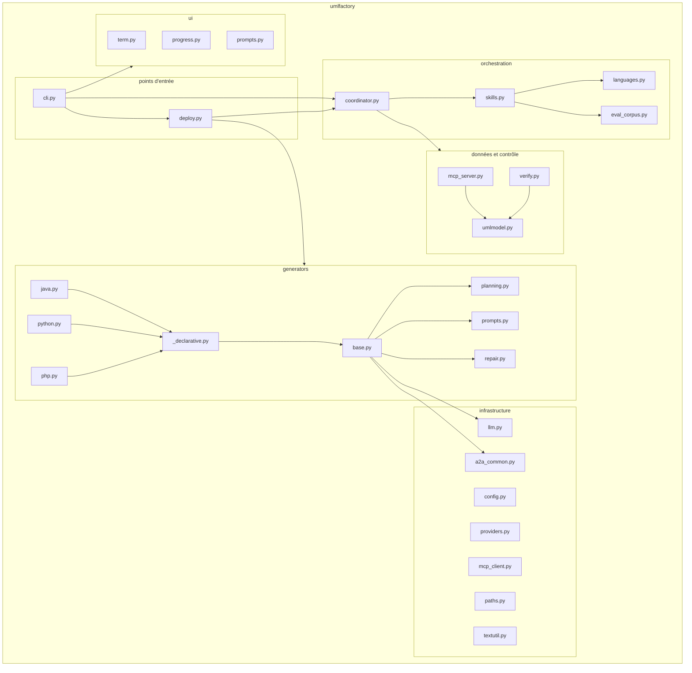

---

## 5. Diagramme de classes

**Explication** : conception objet. `BaseGeneratorAgent` porte la mécanique commune d'un agent de langage (plan, écriture, réparation, verdict) ; `_declarative.CommandGenerator` permet de définir un langage en quelques attributs (comme `KotlinGenerator` ci-dessous, exemple du readme) ; `JavaGenerator` et `PythonGenerator` ajoutent leur vérification d'exécution propre via `runtime()`.

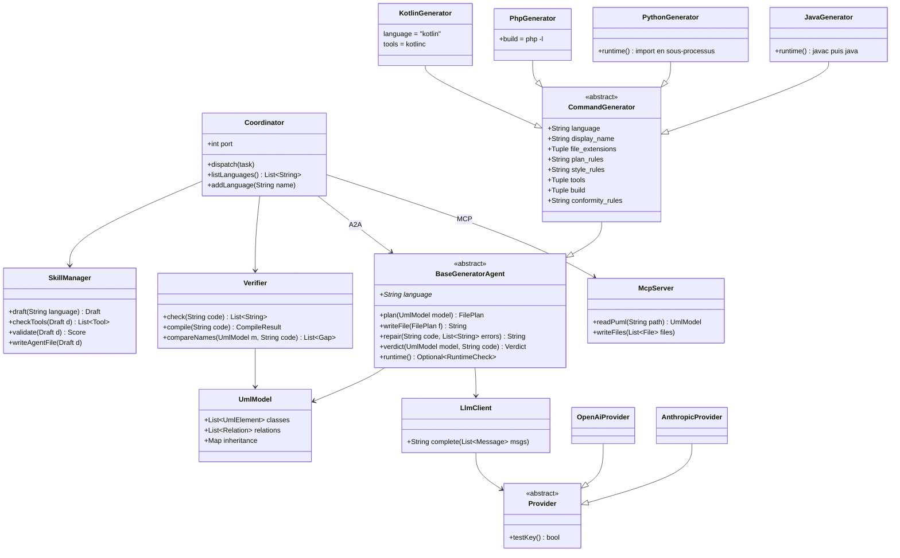

---

## 6. Diagramme d'objets

**Explication** : instantané pendant une génération Java de `examples/model.puml` : le coordinateur a délégué à l'agent Java (port 9101), deux fichiers sont en cours, l'un en correction après un échec de compilation `javac`.

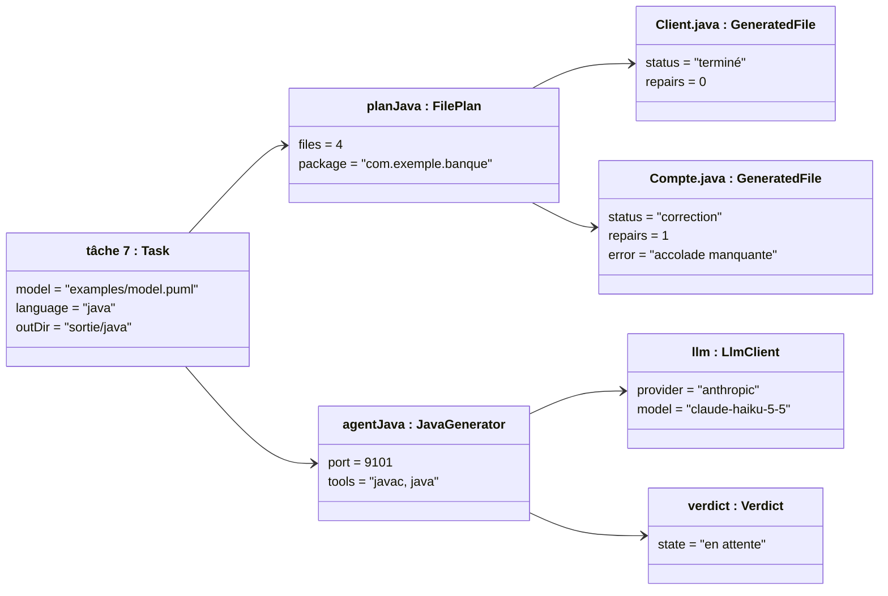

---

## 7. Diagramme de cas d'utilisation

**Explication** : ce que l'utilisateur fait avec le SMA. Le cas principal « Convertir un diagramme » inclut le choix du fournisseur de modèle, le démarrage de la pile et la vérification du code. « Ajouter un langage » (menu « Autre langage… » ou `--add-language`) et la gestion de la pile (`--keep-running`, `--stop`, `deploy`) sont des cas séparés.

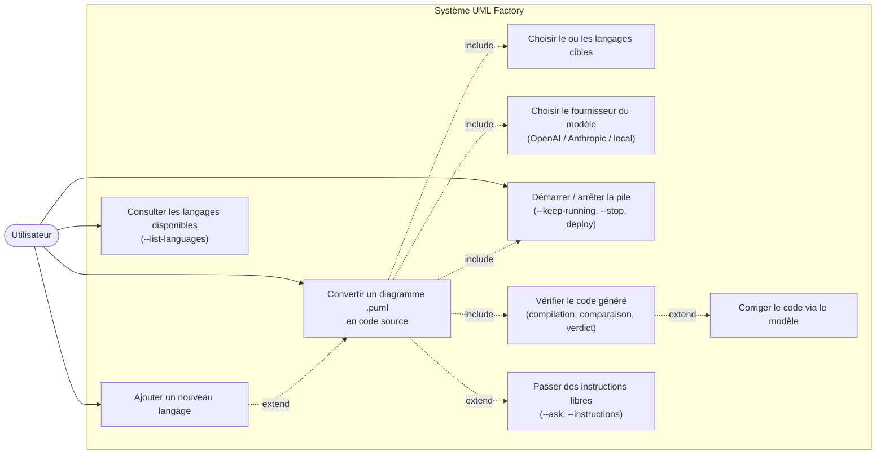

---

## 8. Diagramme de séquence — génération nominale

**Explication** : déroulé complet d'une conversion. La CLI teste les clés du `.env`, allume la pile, envoie la demande au coordinateur (A2A). Le coordinateur lit le `.puml` via MCP, l'agent de langage demande un plan au modèle, fait écrire chaque fichier, puis le coordinateur fait vérifier le code et rend le verdict. La CLI écrit les fichiers et éteint la pile.

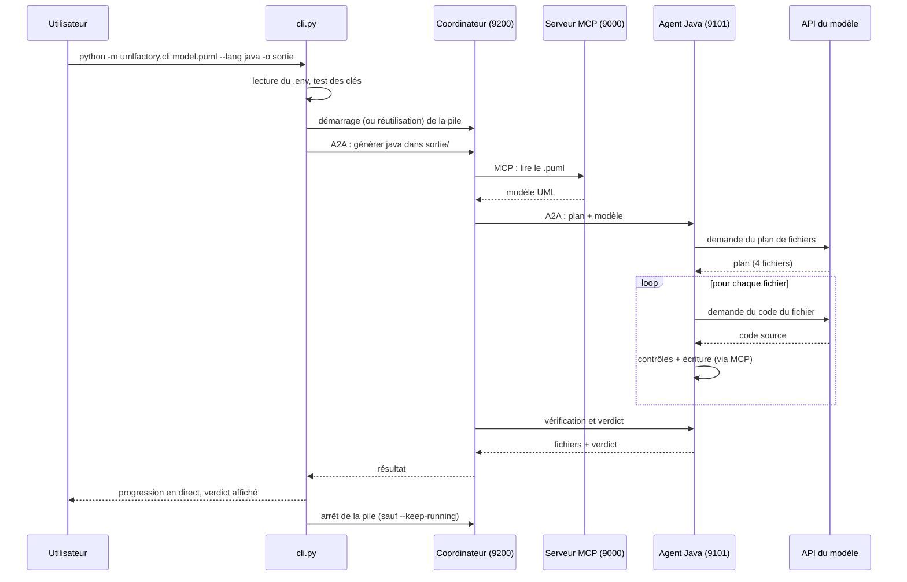

---

## 9. Diagramme de séquence — vérification et verdict

**Explication** : zoom sur la boucle de fiabilité. Chaque fichier subit les contrôles du langage, la compilation (budget 10 s), la comparaison des noms avec le diagramme, puis jusqu'à 2 tours de correction par le modèle. Enfin le modèle rend son verdict de conformité.

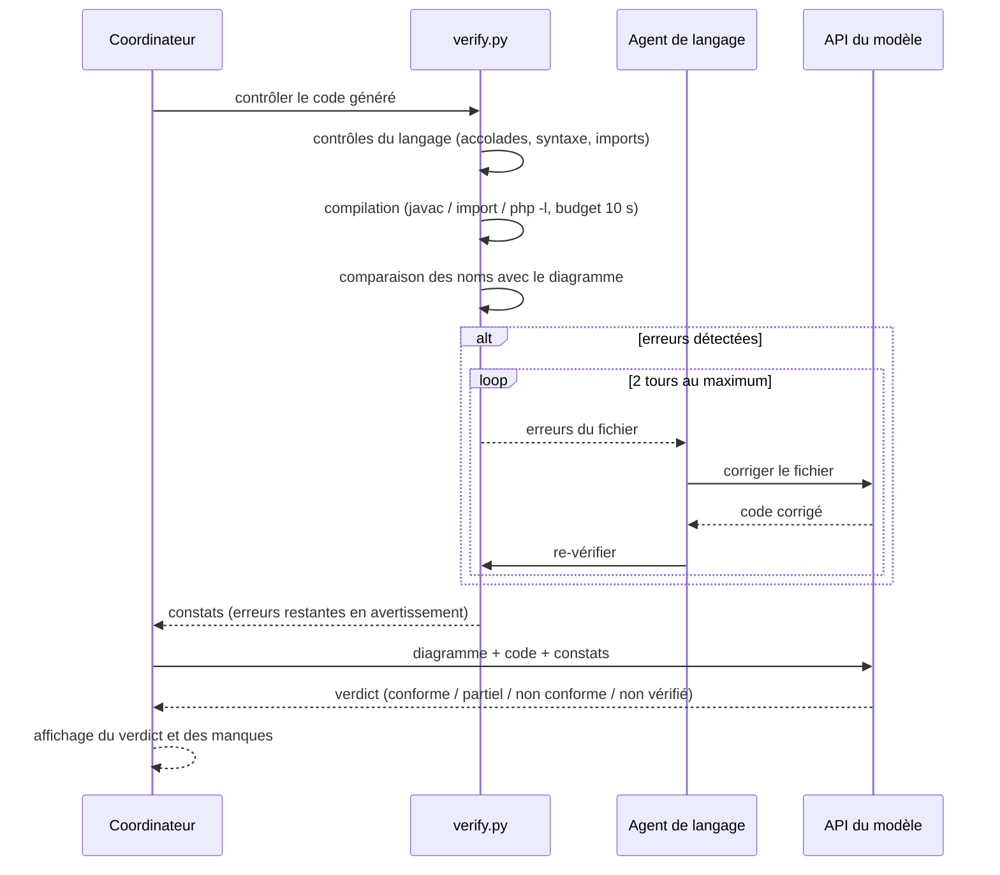

---

## 10. Diagramme de séquence — ajout d'un langage

**Explication** : le SMA se réécrit lui-même partiellement : le modèle rédige des **données** (jamais du code Python), la CLI vérifie les outils, demande l'autorisation pour la commande de vérification, teste l'agent sur les diagrammes de référence (score 75/100 requis), puis génère le fichier d'agent depuis un gabarit fixe.

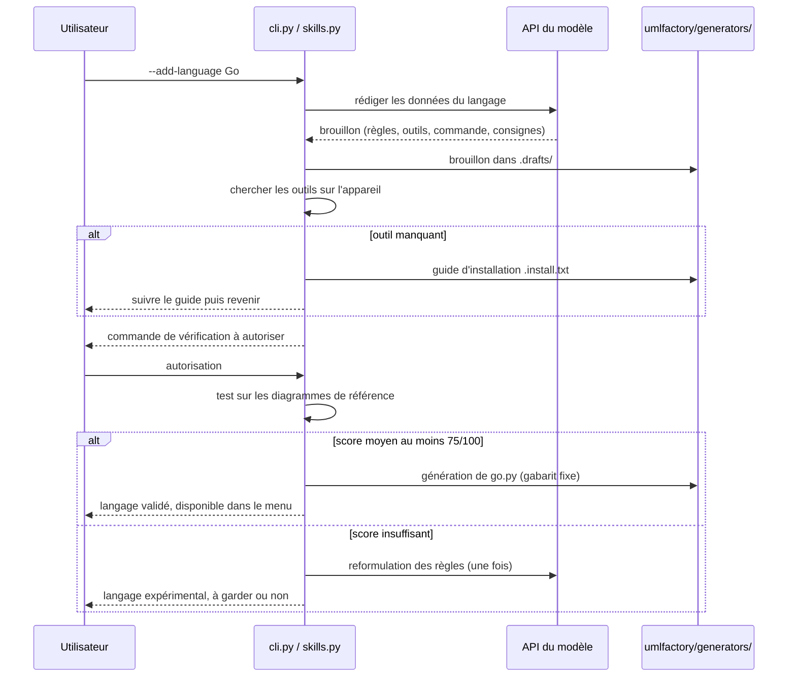

---

## 11. Diagramme de communication

**Explication** : le scénario nominal vu comme collaboration numérotée : qui parle à qui, dans quel ordre.

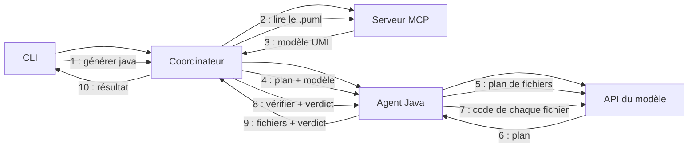

---

## 12. Diagramme d'activité — ajout d'un langage

**Explication** : version activité de la section 10, avec les deux points de décision (outils présents, score de validation) et la boucle de reformulation unique des règles.

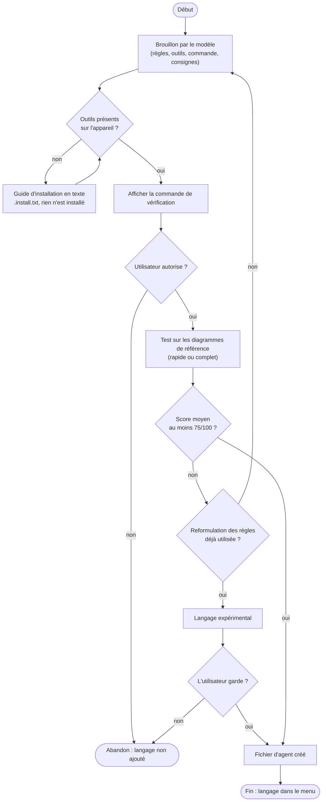

---

## 13. Diagramme d'états — fichier généré

**Explication** : les états affichés en direct par la CLI pour chaque fichier, avec la boucle de correction limitée à 2 tours.

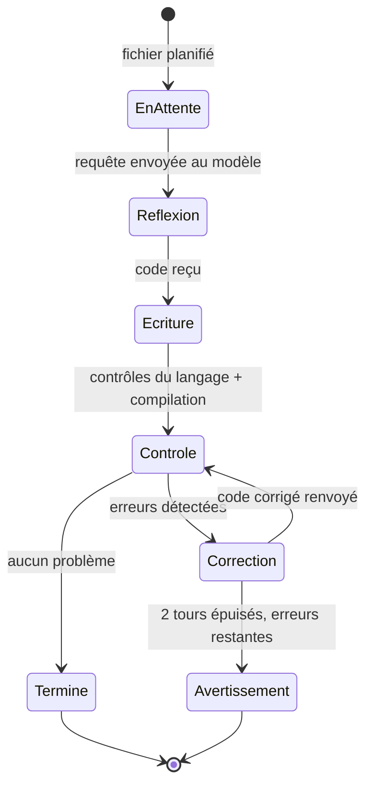

---

## 14. Diagramme d'états — la pile

**Explication** : les trois situations documentées du cycle de vie de la pile, pilotées par `COORDINATOR_URL` (démarrage automatique seulement si l'adresse est locale), `--keep-running`, `--stop` et `deploy.py`.

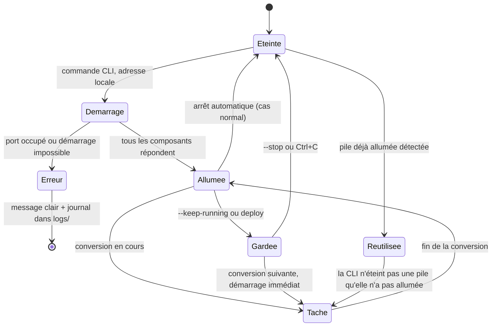

---

## 15. Diagramme d'états — verdict de conformité

**Explication** : les quatre verdicts possibles et leurs conditions, tels que définis dans le readme.

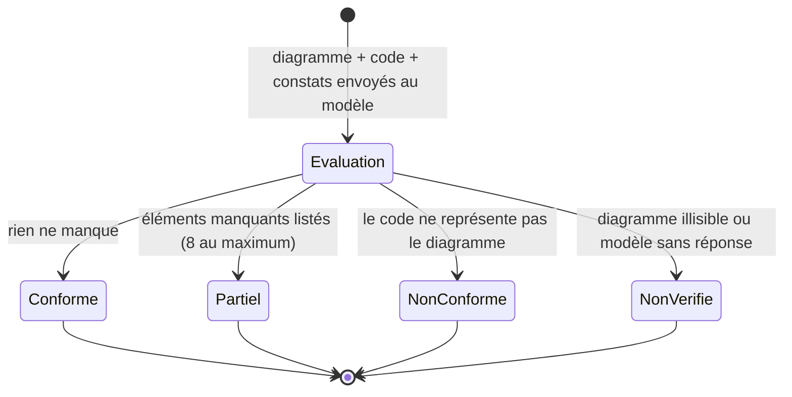

---

## 16. Chronologie d'une exécution

**Explication** : vue temporelle condensée d'une conversion Java, utile en soutenance.

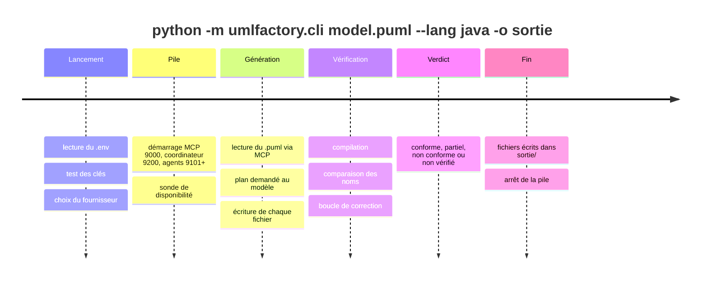

---

## 17. Carte mentale de l'architecture

**Explication** : synthèse visuelle de tout le projet.

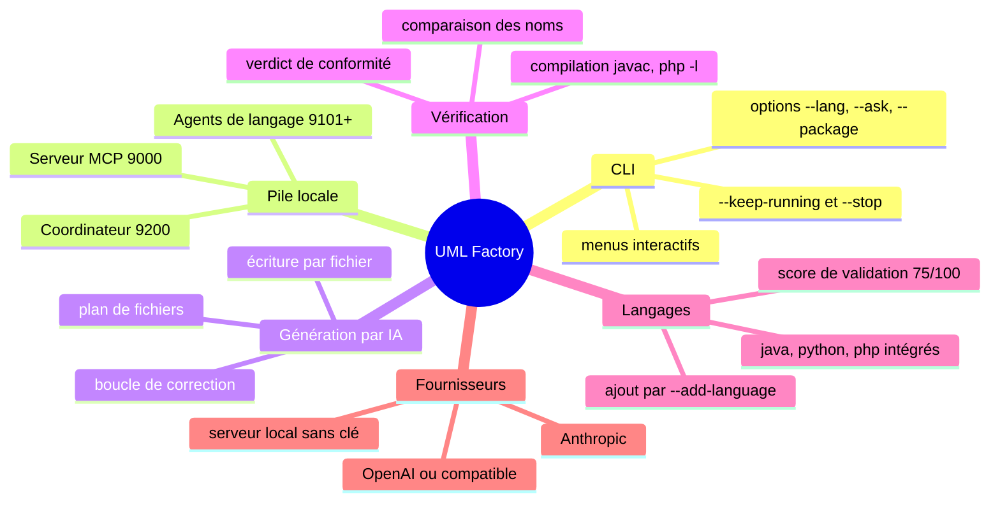

---

## Récapitulatif des vues UML couvertes

| Vue UML | Diagramme | Section |
| --- | --- | --- |
| Statique — structure logique | Composants | 2 |
| Statique — structure physique | Déploiement | 3 |
| Statique — organisation du code | Paquetages | 4 |
| Statique — conception objet | Classes | 5 |
| Statique — instantané | Objets | 6 |
| Dynamique — besoins | Cas d'utilisation | 7 |
| Dynamique — interactions | Séquences (nominal, vérification, ajout de langage) | 8, 9, 10 |
| Dynamique — interactions | Communication / collaboration | 11 |
| Dynamique — flux | Activité (ajout d'un langage) | 12 |
| Dynamique — machines à états | Fichier généré, pile, verdict | 13, 14, 15 |
| Transverses | Chronologie, carte mentale | 16, 17 |